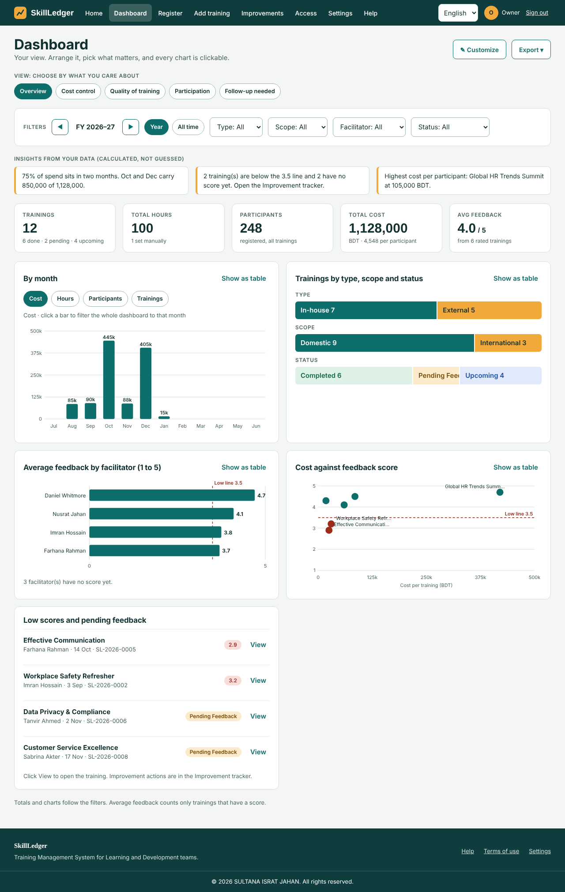
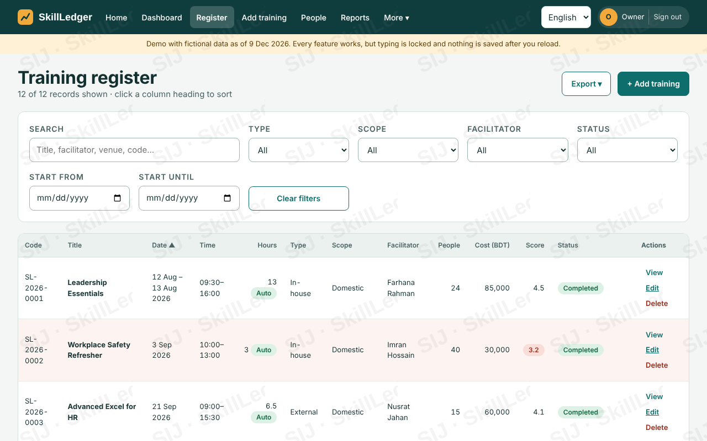
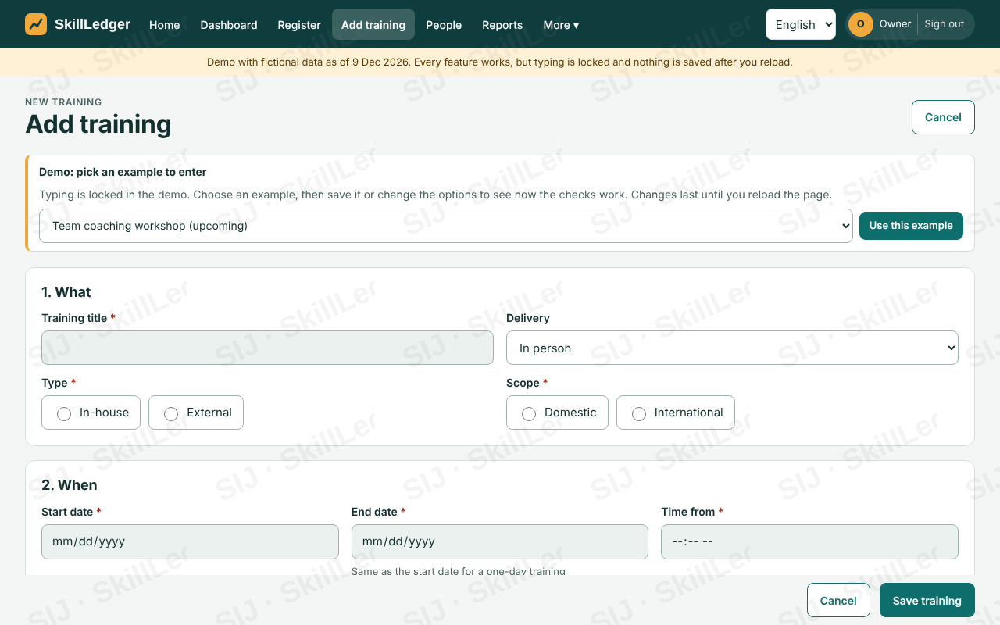

# SkillLedger: Training Management System

A training register and dashboard for Learning & Development (L&D) managers.
Built for an "AI in HR" capstone competition. All data in this demo is fictional.

**Live demo:** https://Sultana-Israt-Jahan.github.io/SkillLedger-demo/

## What it does (version 1)

- Logs each training with 15 fields: title, dates, times, duration, type, scope, facilitator, learning targets, competencies, participants, venue, cost, feedback score and key improvements.
- Calculates duration automatically as (end time − start time) × number of days. A manual override is shown as "Manual" and can be reset.
- Handles sessions that end after midnight with an explicit "Ends next day (+1)" tick, and keeps a time zone per training.
- Sets status automatically: **Upcoming**, **Completed** or **Pending Feedback**.
- Validates input: participants are whole numbers (0 or more), cost is 0 or more, feedback is 1 to 5 with at most one decimal and is rejected outside that scale.
- Register with search, sort, filters and totals.
- Dashboard with KPIs and five clickable charts, financial-year filter and calculated insights.
- Improvement tracker that highlights low feedback scores.
- Export to Excel, CSV, Word, PDF (print) and a JSON backup.
- Owner passcode, viewer codes, lock states and a login log.
- English and Bangla interface, three themes, built-in user manual.

| Register | Add training |
|---|---|
|  |  |

## Demo and full version

This public page is a **demo build of the full system**. Every screen and feature is the same as in the full version: add and edit training, register, dashboard, improvement tracker, exports, access control, settings and the manual. In the demo only the data differs:

- It opens with 12 fictional records.
- Typing is locked. To try the form, pick a demo example (valid ones, and ones that trigger the checks such as a score of 6 or a session ending after midnight without the tick).
- Changes last only until the page is reloaded, and nothing is stored or sent anywhere.

The full version is developed privately and presented in the competition.

## Try it

1. Open the live demo (or open `index.html` in a browser).
2. Open **Add training**, pick a demo example and save it. Try the examples under "Shows a check" to see validation.
3. Explore the register, dashboard, improvement tracker, exports and the user manual.

## Honest limits

- Data stays in your own browser. Nothing is sent to a server, and nothing is shared between visitors.
- The passcode and viewer codes are checked inside the browser. They keep casual visitors out but are not bank-level security. Use fictional data only.
- Version 1 has no email or SMS, no live exchange rates and no sync between computers.
- Tested in Chromium only (see [test report](TEST_REPORT.md)).

## Roadmap

- **v2:** employee directory, nominations, attendance, cost distribution, reports by trainer, employee, team and department.
- **v3:** personal assessment links, employee portal, exam history, manager views.
- **v4:** result import, optional sync, follow-up kit, AI helpers.

## How it was built

The system was designed and specified by the author and built with AI assistance (Claude). Requirements, decisions, review of every result and the test plan are the author's; the AI wrote and tested the code against that plan. The prompt log and verification notes are part of the competition submission.

## Author

Sultana Israt Jahan. MSc in Biotechnology and Genetic Engineering; PGD in Applied Human Resource Management (ongoing).

See [CHANGELOG](CHANGELOG.md) for versions.
